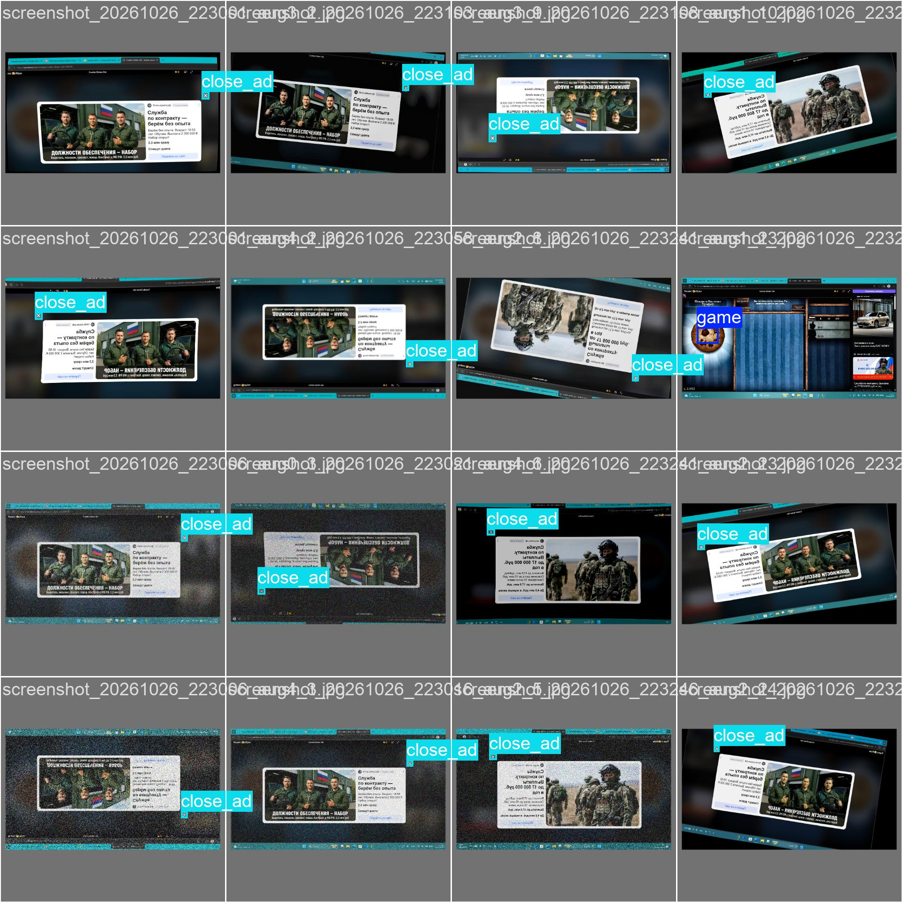
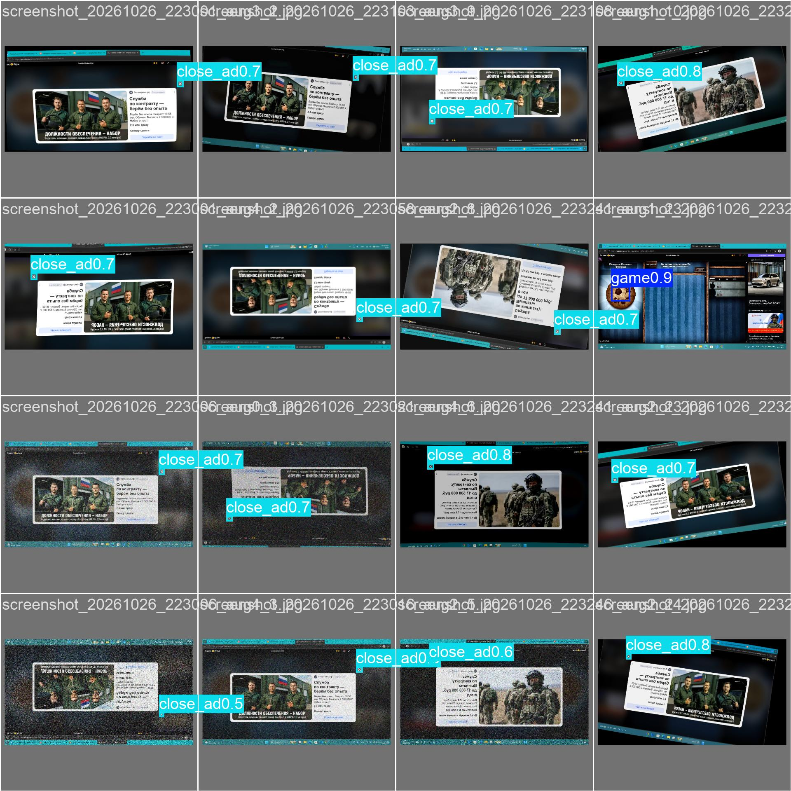
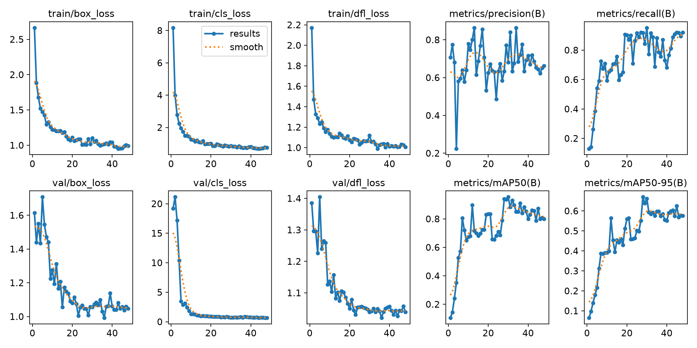
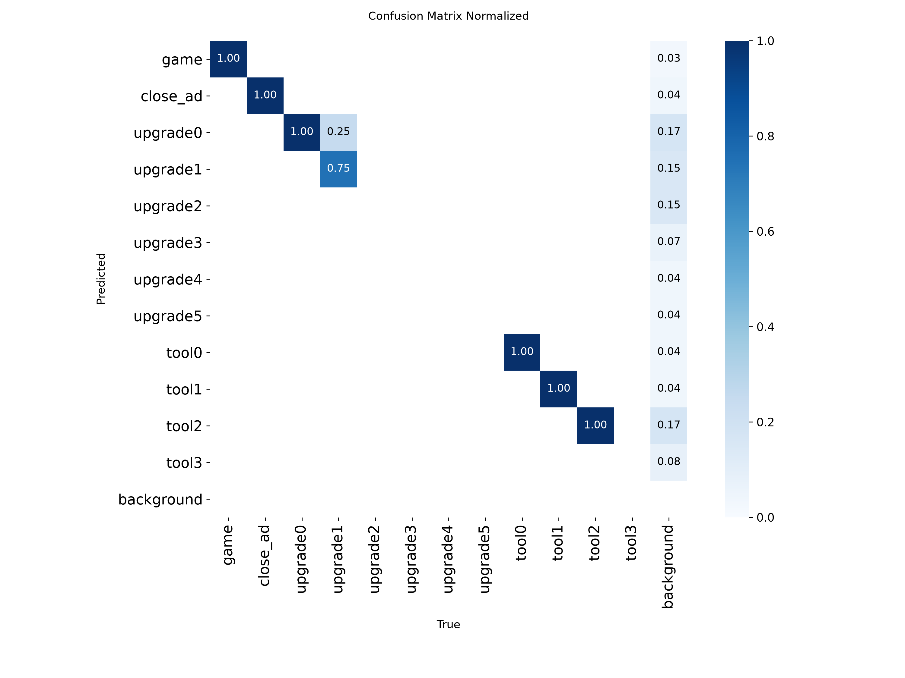
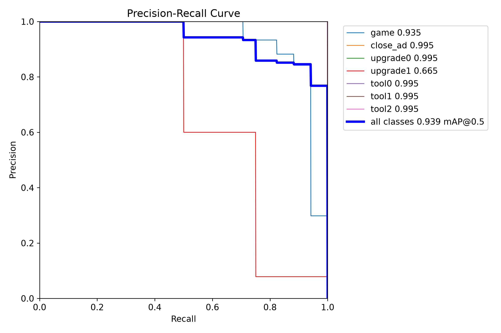
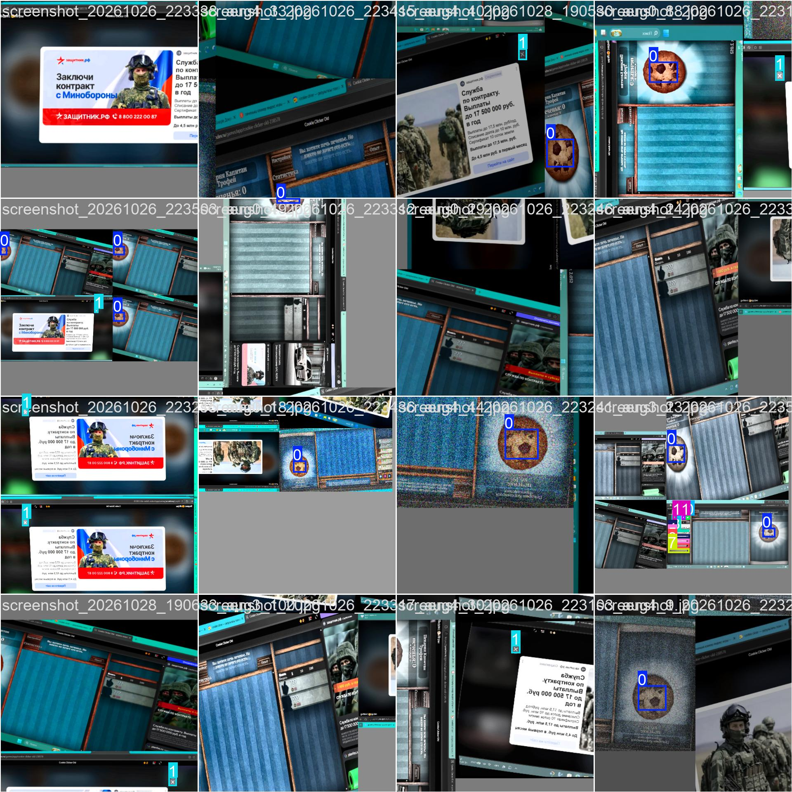

# Last Cookie Detector 🍪

An AI-powered **Cookie Clicker** assistant that detects in-game objects with **YOLOv8** and automates clicking/purchasing with **PyAutoGUI**.

> Repository: `Daler-sys/last_cookie_detector`

## What it does

- **Detects** the main cookie, close-ad button, and purchasable upgrades/tools on screen in real time.
- **Auto-clicks** the cookie for fast cookie generation.
- **Auto-buys** available upgrades/tools on a cooldown, with configurable delays.
- **Handles ads** by detecting and clicking the close button.
- **Pause/resume** anytime with a hotkey (`Space` by default).

## Detected classes

The trained model recognizes 12 classes (from `yaml n py/class.txt` / `data.yaml`):

| Class | Purpose |
|---|---|
| `game` | Main cookie to click |
| `close_ad` | Close advertisement button |
| `upgrade0`–`upgrade5` | Store upgrades |
| `tool0`–`tool3` | Store tools/buildings |

## Demo / Training evidence

These artifacts come from the YOLO training run in this repository (`runs/detect/cookie_detector-6`).

### Validation predictions

| Labels | Predictions |
|---|---|
|  |  |

### Training metrics



### Confusion matrix



### PR curve



### Sample training batch



## Project structure

```text
.
├── README.md
├── pyproject.toml
├── uv.lock
├── runs/
│   └── detect/
│       └── cookie_detector-6/      # training outputs, weights, plots
└── yaml n py/
    ├── app.py                      # main auto-clicker (PyAutoGUI + YOLO)
    ├── onnx_app.py                 # ONNX runtime variant
    ├── train.py                    # YOLOv8 training script
    ├── data.yaml                   # dataset config/classes
    ├── class.txt                   # class names
    ├── augument.py                 # augmentation helpers
    ├── split_dataset.py            # dataset split utility
    ├── screener.py                 # screenshot helper
    ├── proverka.py                 # quick check utility
    └── pt_to_onnx.py               # export PT -> ONNX
```

## How it works

1. **Capture screen** via `pyautogui.screenshot()`.
2. **Run YOLO inference** with the trained `best.pt` weights.
3. **Filter detections** by class-specific confidence thresholds.
4. **Act by priority**:
   - close ads first,
   - buy upgrades/tools when purchase cooldown allows,
   - click the main cookie repeatedly.
5. **Repeat** until paused (`Space`).

## Installation

> The project was developed on Windows (screen automation with PyAutoGUI/keyboard).

```bash
# clone
git clone https://github.com/Daler-sys/last_cookie_detector.git
cd last_cookie_detector

# install dependencies (uv recommended)
uv sync
# or: pip install -e .
```

Main dependencies: `ultralytics`, `opencv-python`, `pyautogui`, `keyboard`, `torch`, `onnxruntime`, `albumentations`.

## Usage

### Run the auto-clicker

```bash
python "yaml n py/app.py"
```

- Press **Space** to pause/resume.
- Adjust thresholds/timings in `CONFIG` inside `yaml n py/app.py`.
- Default model path points to `runs/detect/cookie_detector-6/weights/best.pt`.

### Train your own detector

Prepare a YOLO dataset matching `yaml n py/data.yaml`, then:

```bash
python "yaml n py/train.py"
```

Training config highlights (from run args): YOLOv8n base, 200 epochs, imgsz 640, batch 32, patience 20, copy-paste 0.3.

### Export to ONNX

```bash
python "yaml n py/pt_to_onnx.py"
python "yaml n py/onnx_app.py"
```

## Notes

- `pyautogui` controls your real mouse; keep the game visible on screen.
- Use pause hotkey before switching windows.
- Detection quality depends on game scale/theme matching the training data.

## Author

**Daler Ismail-zade** ([@Daler-sys](https://github.com/Daler-sys))
